<div align="center">


# OShin

**面向 ColorOS 16 的系统增强 Xposed 模块**

状态栏、控制中心、桌面、锁屏到系统框架，70 多个系统应用、2000 多个可调选项，全部默认关闭、按需开启。

**简体中文** | [English](./README_EN.md) | [在线文档](https://oshin.mikusignal.top/)

<a href="https://github.com/suqi8/OShin/releases"></a>
<a href="https://github.com/suqi8/OShin/releases"></a>
<a href="https://modules.lsposed.org/module/com.suqi8.oshin"></a>
<a href="https://github.com/suqi8/OShin/stargazers"></a>
<a href="./LICENSE"></a>

</div>

## 截图

<table>
  <tr>
    <td align="center" valign="top" width="25%">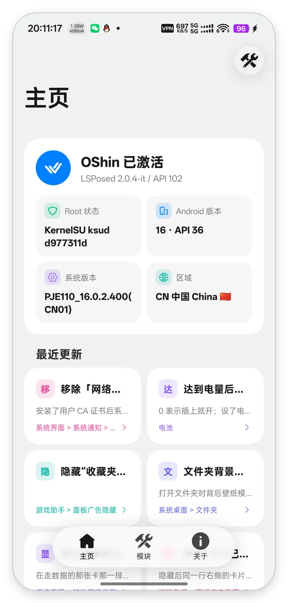<br><b>主页</b><br><sub>激活状态与最近更新</sub></td>
    <td align="center" valign="top" width="25%">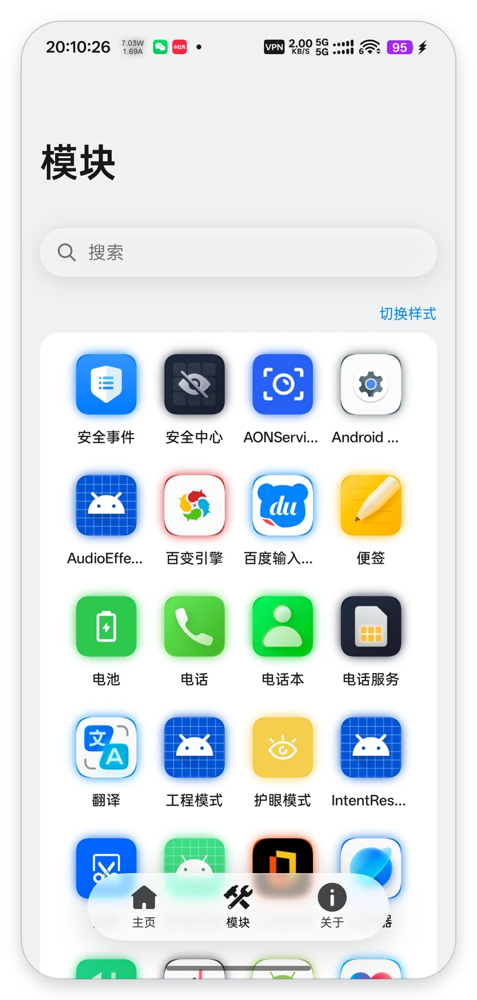<br><b>模块</b><br><sub>按应用进入功能页</sub></td>
    <td align="center" valign="top" width="25%">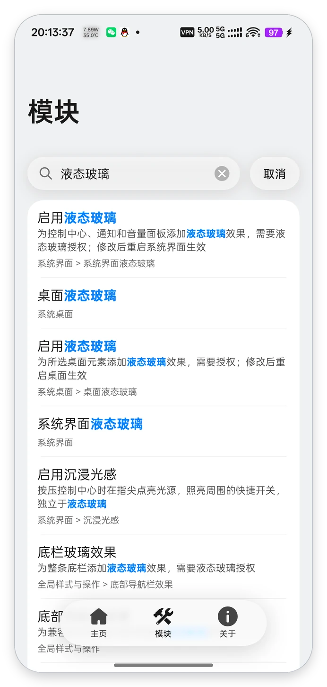<br><b>全局搜索</b><br><sub>按名称或拼音查找选项</sub></td>
    <td align="center" valign="top" width="25%">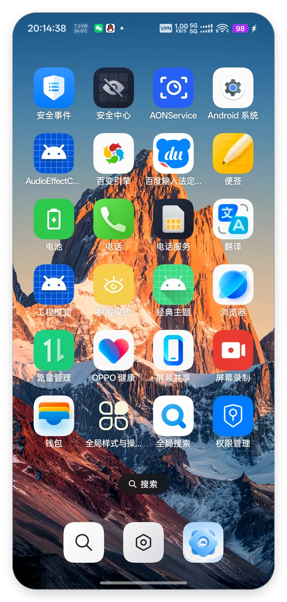<br><b>桌面模式</b><br><sub>应用摆成图标，可建文件夹</sub></td>
  </tr>
  <tr>
    <td align="center" valign="top" width="25%">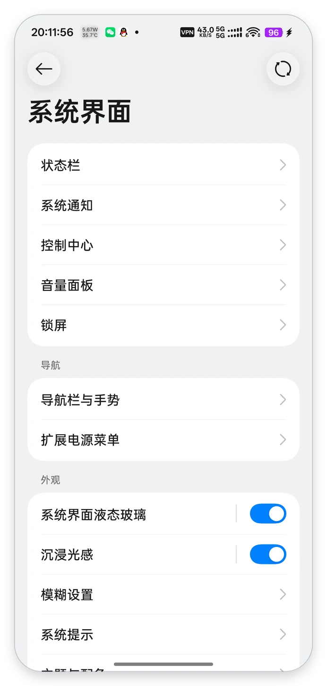<br><b>系统界面</b><br><sub>状态栏、通知、控制中心等</sub></td>
    <td align="center" valign="top" width="25%">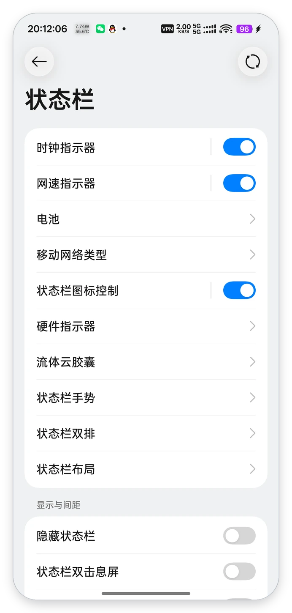<br><b>状态栏</b><br><sub>时钟、网速、图标与手势</sub></td>
    <td align="center" valign="top" width="25%">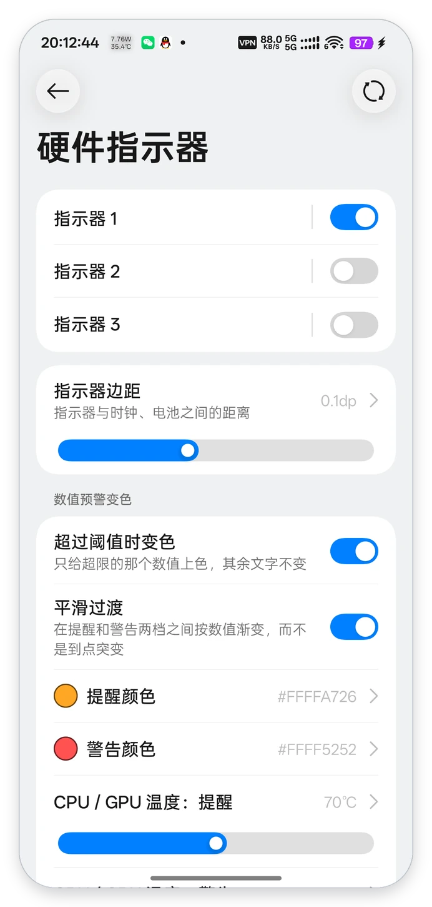<br><b>硬件指示器</b><br><sub>功率、温度等实时数据</sub></td>
    <td align="center" valign="top" width="25%">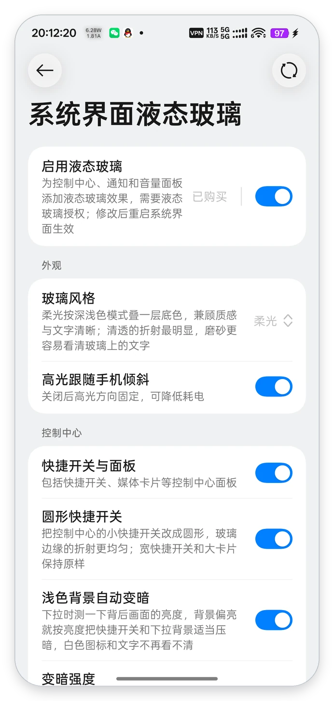<br><b>液态玻璃</b><br><sub>控制中心与通知的玻璃材质</sub></td>
  </tr>
</table>

<details>
<summary><b>更多截图</b></summary>
<br>

<table>
  <tr>
    <td align="center" valign="top" width="25%">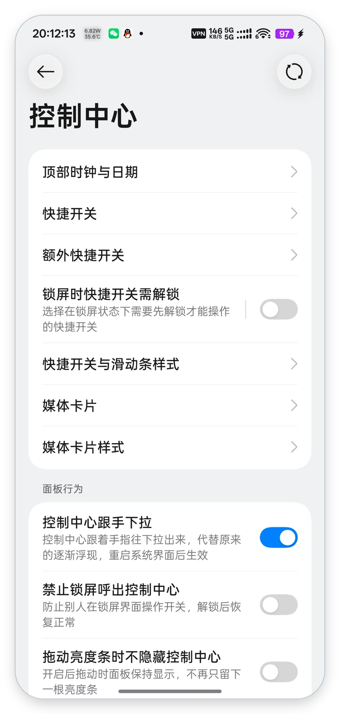<br><b>控制中心</b><br><sub>快捷开关、媒体卡片与下拉行为</sub></td>
    <td align="center" valign="top" width="25%">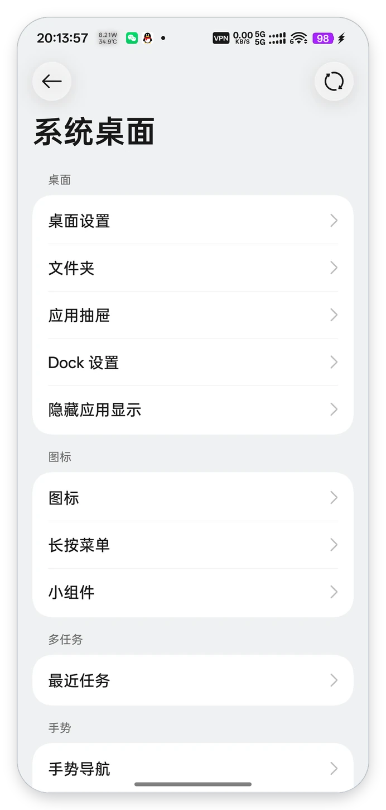<br><b>系统桌面</b><br><sub>图标、文件夹、最近任务与手势</sub></td>
    <td align="center" valign="top" width="25%">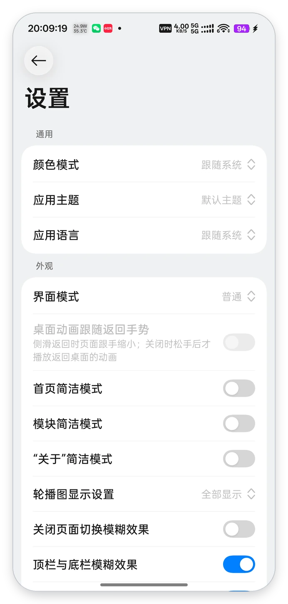<br><b>设置</b><br><sub>界面模式、语言与外观</sub></td>
    <td align="center" valign="top" width="25%">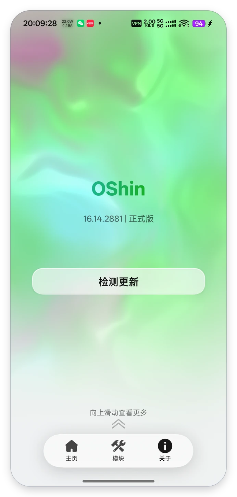<br><b>关于</b><br><sub>版本、更新与更多入口</sub></td>
  </tr>
</table>

</details>

<sub>截图取自 v16.14，运行于 ColorOS 16；状态栏上的功率、网速与双排信号也是模块的功能。</sub>

## 目录

- [截图](#截图)
- [亮点功能](#亮点功能)
- [功能一览](#功能一览)
- [模块自带的工具](#模块自带的工具)
- [支持的应用](#支持的应用)
- [安装与激活](#安装与激活)
- [版本与更新](#版本与更新)
- [常见问题](#常见问题)
- [反馈与社区](#反馈与社区)
- [源码说明](#源码说明)
- [参与贡献](#参与贡献)
- [从源码构建](#从源码构建)
- [项目结构](#项目结构)
- [开源说明](#开源说明)
- [致谢](#致谢)

## 亮点功能

OShin（原名 OPatch）按「应用 → 页面 → 选项」组织功能：在模块页选中一个系统应用，进入对应页面逐项开启。截至 v16.14 共覆盖 76 个应用条目、约 190 个功能页面、2100 多个可调选项，新装后所有选项都是关闭的，不会擅自改动系统。

### 状态栏

- **硬件指示器**：在状态栏实时显示功率、电流、电压、CPU 与电池温度、CPU 频率与占用、内存占用、上下行网速。最多三个指示器，各自选择显示内容与位置，数值超过阈值时自动变色。
- **双排状态栏与双卡信号**：状态栏分上下两排；双卡信号上下堆叠成一个图标，可显示网络制式、漫游标记与流量箭头，卡 1 与卡 2 的上下顺序可互换。
- **时钟指示器**：时钟样式、字体粗细、大小、四向边距、更新频率、深浅背景下的颜色都可单独设置，还能加时钟背景、指定点击时打开的应用。
- **电池条与挖孔电量环**：在屏幕顶部画一条随电量变化的细线，或围绕前摄挖孔画一圈电量环，正常、低电量、充电三种状态各有颜色。
- **网速指示器**：样式、单位、小数位、刷新频率、上下行字号都可调，可强制单排或放到状态栏左侧。
- **图标控制与排序**：逐个隐藏状态栏图标，自定义图标顺序与状态栏布局。

### 控制中心与通知

- **液态玻璃** <sup>付费</sup>：给控制中心、通知和音量面板换上玻璃材质，可选柔光、清透、磨砂风格，高光方向跟随手机倾斜，背景偏亮时自动压暗以保证文字清晰。
- **沉浸光感** <sup>付费</sup>：按压控制中心时在指尖点亮光源，照亮周围的快捷开关。
- **控制中心布局**：顶部时钟与日期、快捷开关与滑动条样式、媒体卡片及其样式；控制中心可改为跟手下拉。
- **横幅通知**：调整横幅位置、显示时长与默认展开状态，让所有通知都弹横幅或在静音时隐藏；另有横幅动画与堆叠通知 <sup>付费</sup>。
- **屏蔽系统通知**：移除「网络可能受到监控」等系统自带的提示通知。
- **流体云**：胶囊的高度、圆角、宽度、边框、颜色与停留时长，展开卡片与动画；炫彩外围 <sup>付费</sup>。
- **音量面板与电源菜单**：音量条显示百分比、调整位置与长度、自定义超时；电源菜单可加手动锁定按钮、隐藏 SOS 按钮并调整按钮排布。

### 锁屏与息屏

- **音乐可视化**：播放音乐时在锁屏显示频谱，频谱样式、颜色模式、发光强度与动画速度可调，也可以显示在通知中心。
- **锁屏细节**：充电动画、指纹图标（含自定义图片）、锁屏通知、解锁行为。
- **息屏**：息屏相关的显示选项，含可由脚本生成的息屏随机文本。

### 桌面

- **图标与布局**：大图标圆角、应用名称多行或滚动显示、自定义名称与颜色、Dock 的图标数量上限、透明度、圆角与高度。
- **文件夹**：解除应用数量与名称长度限制、自定义行列数、调整背景不透明度、隐藏推荐内容。
- **最近任务**：任务卡片样式、卡片信息叠加、动画、显示真实已用内存、移除后台锁定上限。
- **小组件**：任意调整大小、允许任意应用添加小组件、第三方小部件强制圆角。
- **动效**：图标跟随重力晃动、随音乐律动、自定义动画曲线。
- **桌面液态玻璃** <sup>付费</sup>：给所选的桌面元素（如小组件与卡片）换上玻璃材质；另有分区域的模糊设置。
- **布局备份**：把桌面布局存成快照，随时恢复。

### 系统框架

- **包管理服务**：允许应用降级、允许安装 TargetSDK 过低的应用、允许覆盖安装不同签名的应用、禁用安装包签名校验等。
- **安装与卸载**：接管安装器与卸载器、自定义安装来源、允许 ADB 免确认安装、移除不可卸载应用的限制。
- **分享与打开方式**：允许第三方应用设为默认、禁止商店链接强制跳到软件商店、按规则指定链接与文件的打开方式。
- **后台与刷新率**：全局解除后台冻结或自定义保活白名单、解锁并锁定最高刷新率、关闭播放音频时的降刷。
- **分屏与浮窗**：移除浮窗数量与应用限制、任意比例浮窗、从通知或桌面启动时优先用浮窗打开。
- **显示与按键**：分辨率与 DPI、亮度与屏幕、电源键与音量键行为、音量与声音、深色模式支持名单。

### 其他系统应用

- **电池**：自定义充电上限的最低可选值、插电后到指定电量再开启旁路供电、显示电池健康详情。
- **设置**：关于本机里 OTA 卡片的自定义背景（图片或视频）、显示被隐藏的系统页面、调整设置首页条目。
- **游戏助手**：性能与全沉浸模式、特性解锁、隐藏面板里的广告卡片、悬浮面板模糊。
- **相册**：解锁视频导出 GIF、闪速抠图等特性，调整照片最大放大倍数，自定义水印。
- **应用锁**：隐私密码键盘乱序、退出后保持解锁的时长、指定页面跳过验证。
- **全局样式与操作**：对所有应用生效的界面调整，例如给兼容的应用加上底部导航栏玻璃效果、禁止列表边缘回弹。

> 标注「付费」的是少数视觉效果，其余功能全部免费。

## 功能一览

| 范围 | 能调整什么 |
| --- | --- |
| **状态栏** | 时钟指示器与时钟背景、双排状态栏、双卡信号与网络类型、网速指示器、电池条与挖孔电量环、硬件指示器、图标显示与排序、状态栏手势 |
| **控制中心** | 顶部时钟与日期、快捷开关与滑动条样式、媒体卡片、下拉动画、液态玻璃、沉浸光感 |
| **通知与流体云** | 横幅通知、堆叠通知、屏蔽系统通知、流体云胶囊与展开卡片、炫彩外围 |
| **锁屏与息屏** | 音乐可视化、充电动画、指纹图标、锁屏通知、解锁行为、息屏显示 |
| **导航与其他系统界面** | 导航栏与手势、侧滑返回、音量面板、扩展电源菜单、系统提示、模糊设置、主题与配色、USB、低电量提醒 |
| **桌面** | 桌面设置、图标、文件夹、应用抽屉、Dock、小组件、最近任务与任务卡片、桌面手势、长按菜单、动画曲线、分区域模糊、液态玻璃、沉浸光感 |
| **系统框架** | 安装与卸载、包管理服务、分享与打开方式、分屏与浮窗、后台与刷新率、分辨率与 DPI、亮度与屏幕、按键、音量与声音、固定应用、深色模式支持名单 |
| **其他系统应用** | 设置、电池、游戏助手、相册、软件商店、安全中心、电话、信息、天气、主题商店、时钟、日历、文件管理、便签等 |

每个页面里的选项有开关、滑块、下拉、颜色、文本输入、图片与视频选择、应用选择几种形式；依赖其他开关的选项会在前置开关打开后才出现。

## 模块自带的工具

除了改系统，OShin 自己也是一个完整的应用。

**日常使用**

- **全局搜索**：按名称或拼音首字母查找任意选项，直接跳到所在页面并高亮。
- **两种界面模式**：标准的三标签页界面，或把所有应用摆成图标、可拖动整理并建文件夹的桌面模式。
- **主页**：显示激活状态、Root 方案、系统版本和电池的真实容量、健康度与循环次数；作用域缺失时可以直接在这里向框架申请。
- **一键重启目标应用**：每个功能页右上角的按钮会重启该页面对应的应用，改完立即生效。
- **多语言**：简体中文、English、日本語、Русский、한국어、正體中文、Türkçe，可在设置里单独指定，不必跟随系统。

**配置管理**

- **导出与导入**：按页面勾选要导出的设置，可以保存成文件、直接分享或复制成文本；导入时同样逐页选择，支持从剪贴板粘贴别人分享的配置。设备标识、账号凭据与授权状态不会被导出。
- **已修改的功能**：列出所有与默认值不同的选项，点一下跳到对应页面，方便回顾自己改过什么。

**排查问题**

- **模块日志**：读取框架日志与系统崩溃记录，指出出错的应用和可能相关的功能，可一键打包导出用于反馈。
- **注入状态探测**：检测各作用域应用是否已成功注入、运行的是否为当前版本，并可直接重启未响应的应用。
- **DexKit 缓存管理**：查看并清除各应用的搜索缓存，目标应用更新后功能异常时可以先试这一步。

**进阶玩法**

- **快捷开关磁贴**：显示刷新频率、启用 5G、全局静音、Google 移动服务、强光模式、转为浮窗，添加到控制中心即可使用。
- **JS 脚本槽位**：在指定位置用 JavaScript 决定显示什么内容，目前有硬件指示器文本、运营商文本、状态栏时钟、状态栏电量文字、控制中心日期、锁屏签名、上滑解锁提示、息屏随机文本、系统提示文字九个槽位。脚本可以用导入码或二维码分享，出错或超时的脚本会被自动停用，脚本中心里可以一键停用全部脚本。
- **本机 MCP 服务**：让你自己的 AI 客户端查询、修改功能设置并读取模块日志。默认关闭；开启后默认只监听本机 `127.0.0.1:8765`，电脑端经 `adb forward` 连接，所有请求都要带访问令牌，且默认只读，需要另行打开「允许修改配置」才能改设置。

## 支持的应用

模块页列出的应用条目共 76 个。下面的名称取自一加设备，OPPO 与 realme 上个别应用名称不同；设备上没有安装的应用会自动从列表里隐藏。

<details>
<summary><b>展开完整列表</b></summary>
<br>

| 分类 | 应用 |
| --- | --- |
| 系统核心 | Android 系统、系统界面、系统桌面、设置、系统服务、电话服务、软件包安装程序、应用安装器、权限控制器、权限管理、IntentResolver（分享面板）、外部存储设备、文件、照片和视频、NFC 服务、无线设置、应用分身 |
| 通话与信息 | 电话、电话本、信息、骚扰拦截 |
| 安全与电量 | 手机管家、安全中心、安全事件、支付保护、电池、流量管理、通知管理、系统消息、护眼模式 |
| 影像与工具 | 相册、相机、截屏、屏幕录制、屏幕共享、手机投屏、录音、便签、文件管理、日历、时钟、天气、翻译、浏览器 |
| 小布与智能服务 | 小布助手、小布识屏、小布扫一扫、小布输入法、百度输入法定制版、全局搜索、智能侧边栏、智慧决策服务、智慧数据增强服务、AONService、手势体感 |
| 个性化 | 主题商店、乐划锁屏、息屏、经典主题、百变引擎 |
| 服务与互联 | 软件商店、云服务、钱包、OPPO 健康、一加互传、设备互联、游戏助手、软件更新、工程模式、AudioEffectCenter、SmartMediaController |
| 其他 | 全局样式与操作（对所有应用生效），以及 `com.mi.health`、`com.nearme.fusionplay`、`com.oplus.padconnect`、`com.oplus.phonemanager` |

</details>

## 安装与激活

**环境要求**

| 项目 | 要求 |
| --- | --- |
| 系统 | ColorOS 16、realme UI 7、OxygenOS 16（Android 16） |
| Root | Magisk、KernelSU 或 APatch |
| Xposed 框架 | LSPosed 或兼容框架（如 Vector） |

**激活步骤**

1. 安装 APK，在 LSPosed 中启用 OShin，勾选推荐的作用域（系统框架、系统界面、桌面等）。
2. 重启设备。
3. 打开 OShin，主页显示「已激活」即可使用；若提示作用域缺失，点状态卡片直接补全。
4. 在模块页进入对应应用开启需要的功能，用页面右上角的按钮重启该应用使其生效。涉及系统框架的功能需要重启设备。

首次打开时会有一段引导，帮你确认环境并说明出问题时的恢复方法。

## 版本与更新

| 渠道 | 获取方式 | 说明 |
| --- | --- | --- |
| 正式版 | [GitHub Releases](https://github.com/suqi8/OShin/releases)，或在 LSPosed 管理器的仓库里搜索「OShin」 | 阶段性发布，附完整更新日志 |
| 预览版 | [OShin-Builds](https://github.com/suqi8/OShin-Builds/releases)，或 [Telegram 构建频道](https://t.me/OPatchC) | 每次提交自动构建，功能最新，也可能带来新问题 |

应用内「关于」页可以检测更新。不同渠道的安装包如果无法覆盖安装，说明签名不同，请先导出配置，再卸载重装。

## 常见问题

**开启功能后没有变化？**
先确认该应用已在 LSPosed 作用域内，再用页面右上角的按钮重启目标应用；涉及系统框架的功能需要重启设备。仍然无效时，到「关于」里的注入状态探测看一下目标应用是否已注入。

**某项功能导致应用异常或无法开机？**
在 LSPosed 中停用 OShin，或进入安全模式后关闭对应功能。

**系统升级后功能失效？**
目标应用更新后内部实现可能变化。先更新到最新的预览版，并在 DexKit 缓存管理里清一次缓存；仍有问题时带上模块日志[提交反馈](https://github.com/suqi8/OShin/issues/new/choose)。

**想知道自己改过哪些设置？**
「已修改的功能」会列出所有与默认值不同的选项。换机或重装前，可以先在设置里导出配置。

**为什么模块页里找不到某个应用？**
设备上没有安装的应用会被隐藏，列表底部「列表中找不到您想要的应用？」里可以看到被隐藏的条目。

**支持 Android 15 及更早的系统吗？**
当前版本只针对 Android 16（ColorOS 16 系）适配，更早的系统不在支持范围内。

**付费功能是什么？**
液态玻璃、沉浸光感、炫彩流体云、横幅动画与堆叠通知这几类视觉效果需要授权，在对应页面购买后按设备生效；其余功能全部免费。

## 反馈与社区

- 问题与建议：[GitHub Issues](https://github.com/suqi8/OShin/issues/new/choose)（崩溃、功能失效、回归、新功能请求分别有模板），提交前建议先[搜索已有 Issue](https://github.com/suqi8/OShin/issues?q=is%3Aissue)。反馈时附上模块日志导出的压缩包，能明显加快定位。
- Telegram：[官方频道](https://t.me/OPatchA) · [交流群组](https://t.me/OPatchB) · [自动构建](https://t.me/OPatchC)
- QQ 群：[740266099](http://qm.qq.com/cgi-bin/qm/qr?_wv=1027&k=dbP78P2qCYuR2RxGtwmwCrlMCsh2MB2N&authKey=uTkJAGf0gg7%2Fx%2B3OBPrf%2F%2FnyZY2ntPNvnz6%2BTUo%2BHa0Pe%2F%2FqtXvK%2BSJ3%2B4PS0zbO&noverify=0&group_code=740266099)
- 文档：[oshin.mikusignal.top](https://oshin.mikusignal.top/)

## 源码说明

- 自 2025 年 11 月 12 日起，主仓库已转为私有，公开仓库 [suqi8/OShin](https://github.com/suqi8/OShin) 仅作为镜像保留以供参考。
- 后续不再公开源码及功能实现方案。
- 想参与 OShin 开发，请联系 `3383787570@qq.com`。
- 最新动态见[反馈与社区](#反馈与社区)。
- Issues 仍可正常使用。

> 仓库中保留的代码仍遵守开源协议及下方的[开源说明](#开源说明)。

## 参与贡献

- **代码**：欢迎提交 [Pull Request](https://github.com/suqi8/OShin/pulls)。新功能请保持默认关闭，文案只需要写进 `app/src/main/res/values/strings.xml`，其他语言由翻译平台同步。
- **翻译**：在 [Crowdin](https://zh.crowdin.com/project/opatch) 上参与。
- **适配反馈**：不同机型与系统小版本的差异很多，带日志的失效报告本身就是很有价值的贡献。

<div align="center">
  <a href="https://github.com/suqi8/OShin/graphs/contributors">
    
  </a>
</div>

## 从源码构建

需要 JDK 21、Android SDK（compileSdk 37）以及 NDK 28.2.13676358 与 CMake。

```bash
git clone https://github.com/suqi8/OShin.git
cd OShin
./gradlew :app:assembleDebug
```

产物在 `app/build/outputs/apk/debug/`。没有配置签名时使用 Android 默认的调试签名；要用自己的密钥，在 `local.properties` 里填写 `keyStoreFile`、`keyStorePassword`、`keyAlias`、`keyAliasPassword`。

## 项目结构

| 路径 | 内容 |
| --- | --- |
| `app/src/main/java/com/suqi8/oshin/features/` | 各应用的页面定义：一个页面有哪些选项、键名与默认值 |
| `app/src/main/java/com/suqi8/oshin/hook/` | Hook 实现，按目标应用分目录 |
| `app/src/main/java/com/suqi8/oshin/features/FeatureRegistry.kt` | 应用条目与页面路由的注册表 |
| `app/src/main/java/com/suqi8/oshin/hook/HookEntry.kt` | Xposed 入口 |
| `app/src/main/java/com/suqi8/oshin/hook/OShinHookRegistry.kt` | 目标包名到 Hook 的路由 |
| `app/src/main/java/com/suqi8/oshin/ui/` | 模块自身的界面（Jetpack Compose） |
| `yukihookapi-core/` 等 | 随仓库维护的 YukiHookAPI |
| `native/` | 原生代码 |

一个功能由三部分对齐而成：页面定义里的 `category` 就是偏好文件名，选项的 `key` 就是偏好键，Hook 侧用同名的 `prefs("<category>")` 读取，三者的键名、类型和默认值必须一致。

主要技术栈：Kotlin、Jetpack Compose、[YukiHookAPI](https://github.com/HighCapable/YukiHookAPI)、[libxposed](https://github.com/libxposed/api)、DexKit、Hilt、MMKV。

## 开源说明

本项目基于 [AGPL-3.0](./LICENSE) 开源，欢迎贡献。

但在您修改或分发此应用时，请 **不要更改** 以下内容：

- 「关于」页中的 **感谢** 与 **作者信息**
- 「关于」页中的 **题外话**
- **友盟 SDK** 相关代码
- **中国地区启动验证** 模块

## 致谢

OShin 的实现参考或使用了以下项目，在此致谢：

[YukiHookAPI](https://github.com/HighCapable/YukiHookAPI) · [libxposed](https://github.com/libxposed/api) · [CorePatch](https://github.com/LSPosed/CorePatch) · [HyperCeiler](https://github.com/ReChronoRain/HyperCeiler) · [HyperStar](https://github.com/YunZiA/HyperStar) · [LuckyTool](https://github.com/Xposed-Modules-Repo/com.luckyzyx.luckytool) · [Oxygen-Customizer](https://github.com/DHD2280/Oxygen-Customizer) · [AndroidLiquidGlass](https://github.com/Kyant0/AndroidLiquidGlass) · [coloros-aod](https://github.com/Flyfish233/coloros-aod) · [FreeNotifications](https://github.com/binarynoise/XposedModulets/tree/main/FreeNotifications) · [XposedSmsCode](https://github.com/tianma8023/XposedSmsCode) · [note-watermark](https://github.com/araea/note-watermark)

<details>
<summary><b>项目统计</b></summary>

<div align="center">


<a href="https://star-history.com/#suqi8/OShin&Date">
  
</a>

</div>

</details>
