<div align="center">

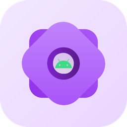

# OShin

**A system enhancement Xposed module for ColorOS 16**

Status bar, control center, launcher, lock screen and the system framework: 70+ system apps and 2000+ options, all off by default until you turn them on.

[简体中文](./README.md) | **English** | [Documentation](https://oshin.mikusignal.top/)

<a href="https://github.com/suqi8/OShin/releases"></a>
<a href="https://github.com/suqi8/OShin/releases"></a>
<a href="https://modules.lsposed.org/module/com.suqi8.oshin"></a>
<a href="https://github.com/suqi8/OShin/stargazers"></a>
<a href="./LICENSE"></a>

</div>

## Screenshots

<table>
  <tr>
    <td align="center" valign="top" width="25%">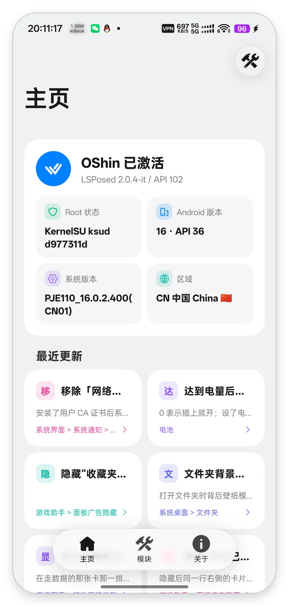<br><b>Home</b><br><sub>Status and recent updates</sub></td>
    <td align="center" valign="top" width="25%">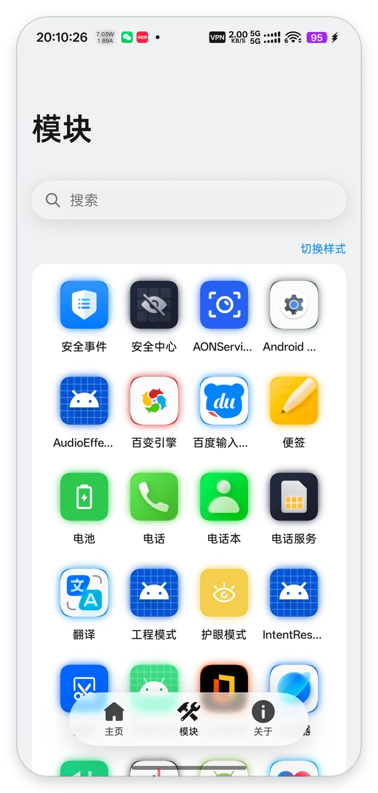<br><b>Modules</b><br><sub>Pick an app to open its pages</sub></td>
    <td align="center" valign="top" width="25%">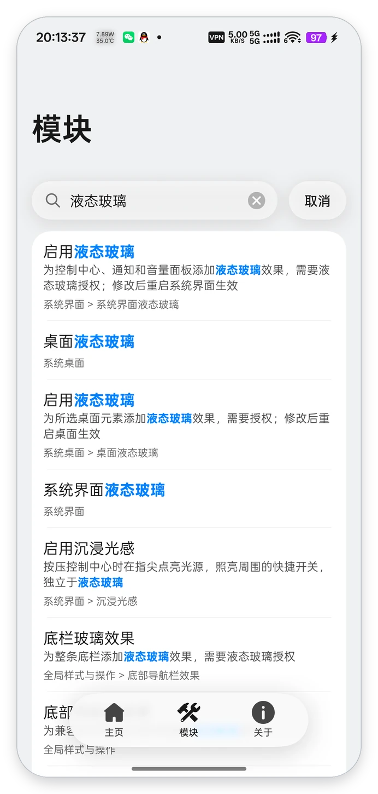<br><b>Global search</b><br><sub>Find options by name or pinyin</sub></td>
    <td align="center" valign="top" width="25%">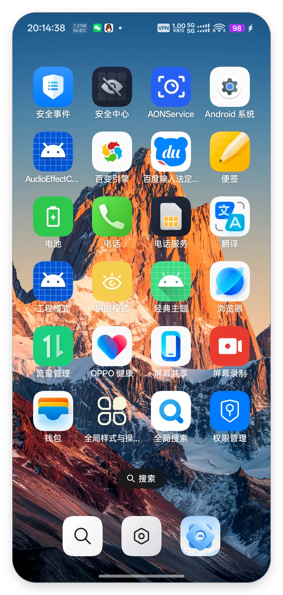<br><b>Desktop mode</b><br><sub>Apps as icons, with folders</sub></td>
  </tr>
  <tr>
    <td align="center" valign="top" width="25%">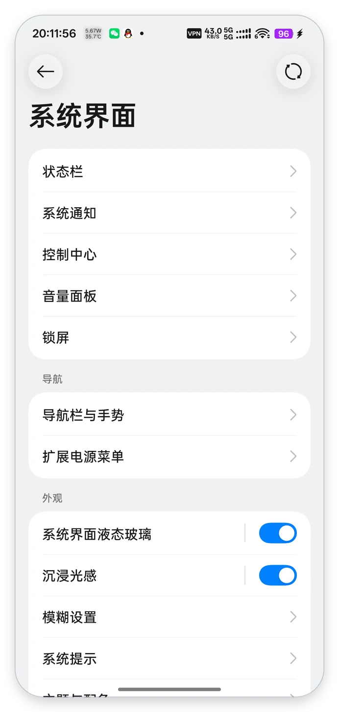<br><b>System UI</b><br><sub>Status bar, notifications, control center</sub></td>
    <td align="center" valign="top" width="25%">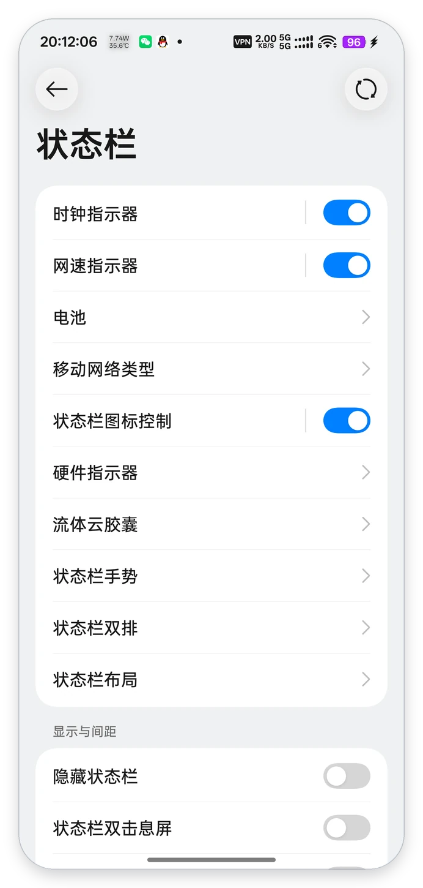<br><b>Status bar</b><br><sub>Clock, network speed, icons, gestures</sub></td>
    <td align="center" valign="top" width="25%">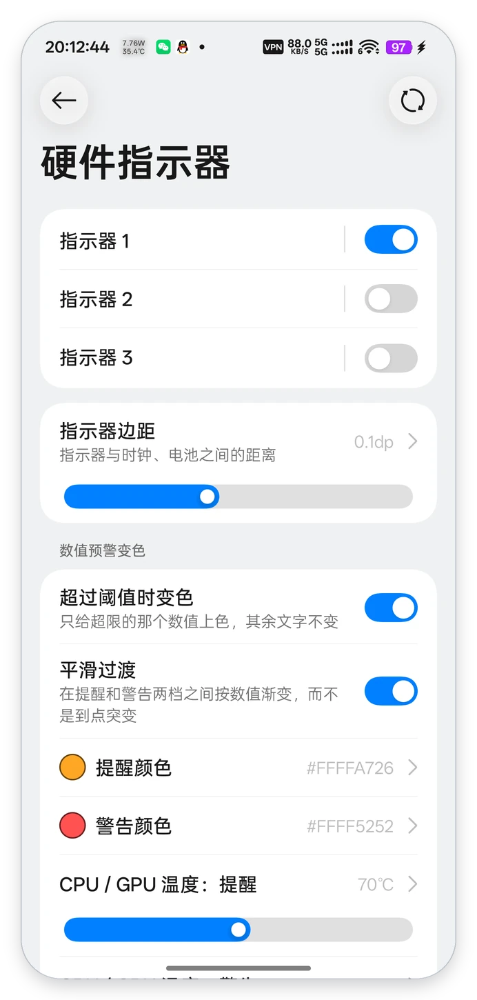<br><b>Hardware indicator</b><br><sub>Live power and temperature readouts</sub></td>
    <td align="center" valign="top" width="25%">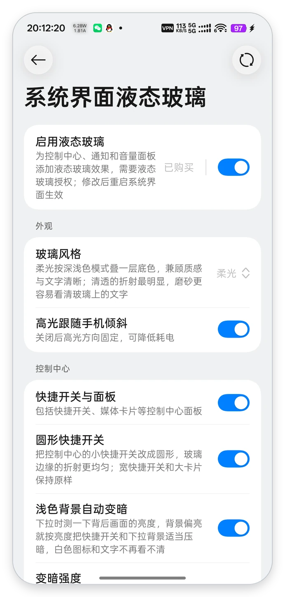<br><b>Liquid Glass</b><br><sub>Glass material for panels and notifications</sub></td>
  </tr>
</table>

<details>
<summary><b>More screenshots</b></summary>
<br>

<table>
  <tr>
    <td align="center" valign="top" width="25%">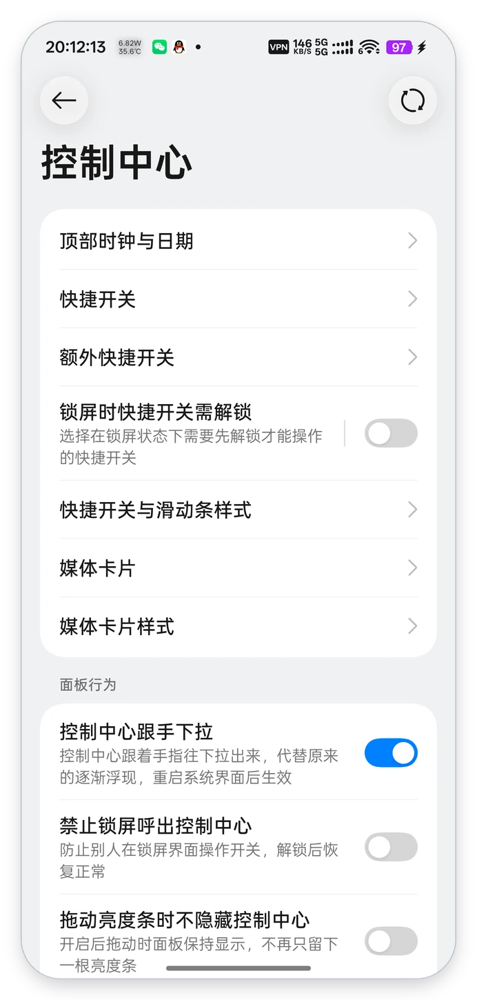<br><b>Control center</b><br><sub>Tiles, media card and pull-down behaviour</sub></td>
    <td align="center" valign="top" width="25%">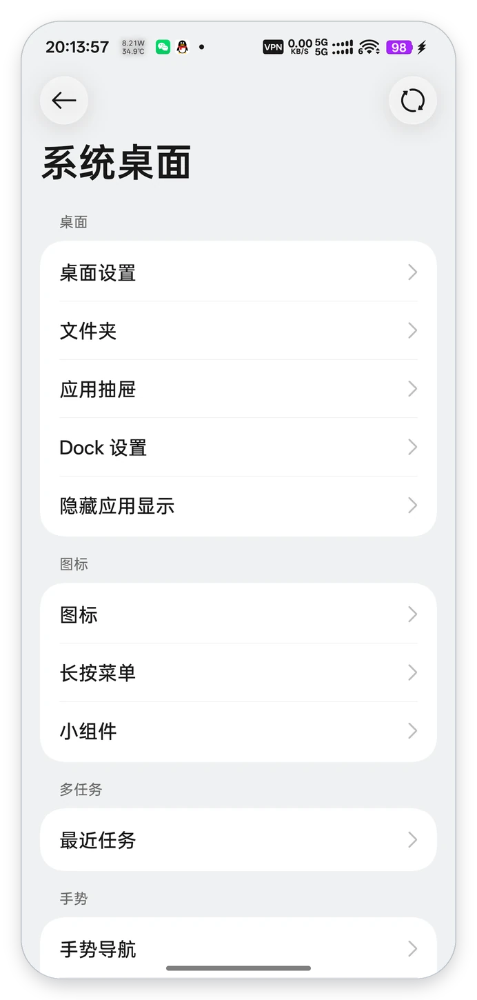<br><b>Launcher</b><br><sub>Icons, folders, recents and gestures</sub></td>
    <td align="center" valign="top" width="25%">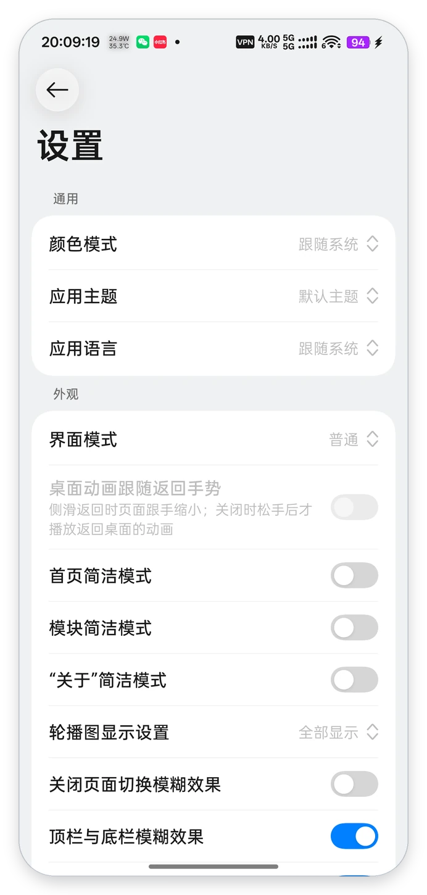<br><b>Settings</b><br><sub>Interface mode, language and appearance</sub></td>
    <td align="center" valign="top" width="25%">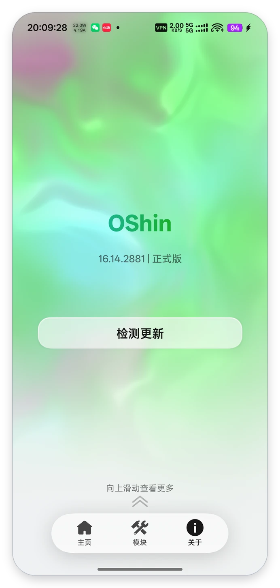<br><b>About</b><br><sub>Version, updates and more entries</sub></td>
  </tr>
</table>

</details>

<sub>Captured on v16.14 running ColorOS 16. The app is shown in Chinese here; English and other languages can be selected in its settings. The power, network speed and dual-row signal readouts in the status bar are module features too.</sub>

## Contents

- [Screenshots](#screenshots)
- [Highlights](#highlights)
- [Feature overview](#feature-overview)
- [Built-in tools](#built-in-tools)
- [Supported apps](#supported-apps)
- [Install and activate](#install-and-activate)
- [Releases and updates](#releases-and-updates)
- [FAQ](#faq)
- [Feedback and community](#feedback-and-community)
- [Source code notice](#source-code-notice)
- [Contributing](#contributing)
- [Build from source](#build-from-source)
- [Project layout](#project-layout)
- [Open source notice](#open-source-notice)
- [Credits](#credits)

## Highlights

OShin (formerly OPatch) organises everything as app → page → option: pick a system app on the Modules tab, open a page and switch on what you need. As of v16.14 it covers 76 app entries, about 190 pages and more than 2100 options. Every option is off after a fresh install, so nothing changes until you ask for it.

### Status bar

- **Hardware indicator**: live power, current, voltage, CPU and battery temperature, CPU frequency and load, RAM usage, and upload and download speed in the status bar. Up to three indicators, each with its own content and position, and values change colour once they pass a threshold.
- **Dual-row status bar and dual-SIM signal**: split the status bar into two rows. The two SIM signals stack into one icon that can show network type, a roaming mark and data arrows, and the order of SIM 1 and SIM 2 can be swapped.
- **Clock indicator**: style, font weight, size, margins on all four sides, update rate and separate colours for light and dark backgrounds, plus an optional clock background and an app to open on tap.
- **Battery bar and cutout ring**: a thin line across the top of the screen that follows the battery level, or a ring around the camera cutout, each with its own colours for normal, low and charging states.
- **Network speed indicator**: style, unit, decimal places, refresh rate and separate font sizes for upload and download, with options to force a single row or move it to the left.
- **Icon control and order**: hide individual status bar icons and rearrange their order and layout.

### Control center and notifications

- **Liquid Glass** <sup>paid</sup>: a glass material for the control center, notifications and the volume panel. Choose between soft, clear and frosted styles; highlights follow the tilt of the phone, and bright backgrounds are dimmed automatically to keep text readable.
- **Immersive Light** <sup>paid</sup>: pressing the control center lights up a point under your finger that illuminates the tiles around it.
- **Control center layout**: header clock and date, tile and slider styles, the media card and its style, and a pull-down that follows your finger.
- **Heads-up notifications**: position, duration and default expanded state, heads-up for every notification, or none while muted. Heads-up animation and stacked notifications are <sup>paid</sup>.
- **Blocking system notices**: remove built-in notices such as "Network may be monitored".
- **Fluid Cloud**: capsule height, corner radius, width, border, colours and display time, plus the expanded card and its animation. The colourful glow is <sup>paid</sup>.
- **Volume panel and power menu**: show percentages on the volume bar, move and resize it, set a custom timeout; add a lockdown button to the power menu, hide the SOS button and rearrange the buttons.

### Lock screen and screen-off

- **Music visualizer**: a spectrum on the lock screen while music plays, with adjustable style, colour mode, glow and animation speed. It can also appear in the notification shade.
- **Lock screen details**: charging animation, fingerprint icon (including a custom image), lock screen notifications and unlock behaviour.
- **Screen-off**: screen-off display options, including random text that a script can generate.

### Launcher

- **Icons and layout**: large icon corner radius, multi-line or scrolling app names, custom names and colours, and the Dock icon limit, opacity, corner radius and height.
- **Folders**: remove the app count and name length limits, set custom rows and columns, adjust background opacity and hide recommendations.
- **Recent tasks**: task card style, info overlays, animations, real used memory and no limit on locked tasks.
- **Widgets**: resize freely, let any app add widgets, force rounded corners on third-party widgets.
- **Motion**: icons that sway with gravity or pulse with music, and custom animation curves.
- **Launcher Liquid Glass** <sup>paid</sup>: a glass material for the launcher elements you choose, such as widgets and cards, alongside per-region blur settings.
- **Layout backup**: save the launcher layout as a snapshot and restore it at any time.

### System framework

- **Package manager services**: allow downgrades, apps with a low target SDK, installs over a different signature, and disable signature verification.
- **Install and uninstall**: take over the installer and uninstaller, set a custom install source, allow ADB installs without confirmation and remove the "cannot uninstall" restriction.
- **Share sheet and open-with**: let third-party apps become defaults, stop store links from being forced into the App Market, and set rules for which app opens which links and files.
- **Background and refresh rate**: lift background freezing globally or keep a custom allow-list alive, unlock and lock the highest refresh rate, stop the refresh rate dropping during audio playback.
- **Split screen and floating windows**: remove limits on the number of floating windows and the apps that support them, use any aspect ratio, and prefer floating windows when launching from notifications or the launcher.
- **Display and keys**: resolution and DPI, brightness and display, power and volume key behaviour, volume and sound, and the dark mode support list.

### Other system apps

- **Battery**: a lower minimum for the charge limit, bypass charging that starts only after a set level, and battery health details.
- **Settings**: a custom image or video background for the OTA card in About device, hidden system pages, and control over the items on the Settings home page.
- **Game Assistant**: performance and full immersion mode, feature unlocks, hiding ad cards in the panel, and blur for the floating panel.
- **Photos**: unlock features such as video-to-GIF export and quick cut-out, change the maximum zoom level and customise watermarks.
- **App lock**: scramble the privacy password keypad, keep apps unlocked for a while after leaving, and let chosen pages skip verification.
- **Global styles and actions**: tweaks that apply to every app, such as a glass bottom navigation bar for compatible apps or no overscroll bounce in lists.

> Items marked "paid" are a handful of visual effects. Everything else is free.

## Feature overview

| Area | What you can change |
| --- | --- |
| **Status bar** | Clock indicator and clock background, dual-row status bar, dual-SIM signal and network type, network speed indicator, battery bar and cutout ring, hardware indicator, icon visibility and order, status bar gestures |
| **Control center** | Header clock and date, tile and slider styles, media card, pull-down animation, Liquid Glass, Immersive Light |
| **Notifications and Fluid Cloud** | Heads-up notifications, stacked notifications, blocking system notices, Fluid Cloud capsule and expanded card, colourful glow |
| **Lock screen and screen-off** | Music visualizer, charging animation, fingerprint icon, lock screen notifications, unlock behaviour, screen-off display |
| **Navigation and other System UI** | Navigation bar and gestures, back gesture, volume panel, extended power menu, system toasts, blur settings, theme and colours, USB, low battery warning |
| **Launcher** | Desktop settings, icons, folders, app drawer, Dock, widgets, recent tasks and task cards, desktop gestures, long-press menu, animation curves, per-region blur, Liquid Glass, Immersive Light |
| **System framework** | Install and uninstall, package manager services, share sheet and open-with, split screen and floating windows, background and refresh rate, resolution and DPI, brightness and display, hardware keys, volume and sound, screen pinning, dark mode support list |
| **Other system apps** | Settings, Battery, Game Assistant, Photos, App Market, Security Center, Phone, Messages, Weather, Theme Store, Clock, Calendar, File Manager, Notes and more |

Options come as switches, sliders, dropdowns, colours, text fields, image and video pickers, and app pickers. Options that depend on another switch only appear once that switch is on.

## Built-in tools

Besides changing the system, OShin is a full app in its own right.

**Everyday use**

- **Global search**: find any option by name or pinyin initials and jump straight to its page with a highlight.
- **Two interface modes**: the standard three-tab layout, or a desktop mode that lays every app out as icons you can drag around and group into folders.
- **Home**: activation status, root solution, system version, and the battery's real capacity, health and cycle count. If a scope is missing you can request it from the framework right there.
- **Restart the target app**: the button at the top right of every feature page restarts the app that page belongs to, so changes take effect immediately.
- **Languages**: Simplified Chinese, English, Japanese, Russian, Korean, Traditional Chinese and Turkish, selectable in settings independently of the system language.

**Managing your configuration**

- **Export and import**: choose which pages to export, then save to a file, share directly or copy as text. Import works page by page too, including pasting a configuration someone shared from the clipboard. Device identifiers, credentials and licence state are never exported.
- **Modified features**: lists every option that differs from its default and takes you to its page, so you can review what you have changed.

**Troubleshooting**

- **Module logs**: reads framework logs and system crash records, points out the failing app and the features likely involved, and packs everything into one archive for a bug report.
- **Injection probe**: checks whether each scoped app has been injected and is running the current version, and can restart an app that does not respond.
- **DexKit cache manager**: view and clear the lookup cache per app. Try this first when a feature misbehaves after the target app updates.

**Going further**

- **Quick settings tiles**: show refresh rate, enable 5G, global mute, Google Mobile Services, high brightness mode and convert to floating window. Add them to the control center to use them.
- **JS script slots**: decide with JavaScript what is displayed in certain places. There are nine slots today: hardware indicator text, carrier text, status bar clock, status bar battery text, control center date, lock screen signature, swipe-to-unlock hint, screen-off random text and system toast text. Scripts can be shared as an import code or QR code, a script that fails or times out is disabled automatically, and the script center can stop all scripts at once.
- **Local MCP server**: lets your own AI client query and change settings and read module logs. It is off by default. Once enabled it listens only on `127.0.0.1:8765`; a computer connects through `adb forward`, every request needs the access token, and it is read-only until you turn on "Allow changing settings".

## Supported apps

The Modules tab lists 76 app entries. Names below follow a OnePlus device and a few differ on OPPO and realme; apps that are not installed on your device are hidden from the list automatically.

<details>
<summary><b>Show the full list</b></summary>
<br>

| Category | Apps |
| --- | --- |
| System core | Android System, System UI, System Launcher, Settings, System Services, Phone Services, Package Installer, App Installer, Permission Controller, Permission Manager, IntentResolver (share sheet), External Storage, Files, Photo Picker, NFC Service, Wireless Settings, App Cloner |
| Calls and messages | Phone, Contacts, Messages, Block & Filter |
| Security and power | Phone Manager, Security Center, Security Events, Payment Protection, Battery, Data Usage, Notification Manager, System Messages, Eye Comfort |
| Media and tools | Photos, Camera, Screenshot, Screen Recorder, Screen Share, Screencast, Recorder, Notes, File Manager, Calendar, Clock, Weather, Translate, Browser |
| Breeno and smart services | Breeno Assistant, Breeno Screen Recognition, Breeno Scan, Breeno Keyboard, Baidu IME (OPPO edition), Global Search, Smart Sidebar, Smart Decision Service, Scene Service, AONService, Air Gestures |
| Personalisation | Theme Store, Lock Screen Magazine, Always-On Display, Classic Themes, UI Engine |
| Services and connectivity | App Market, Cloud, Wallet, OPPO Health, OnePlus Share, Device Connect, Game Assistant, Software Update, Engineering Mode, AudioEffectCenter, SmartMediaController |
| Other | Global styles and actions (applies to every app), plus `com.mi.health`, `com.nearme.fusionplay`, `com.oplus.padconnect` and `com.oplus.phonemanager` |

</details>

## Install and activate

**Requirements**

| Item | Requirement |
| --- | --- |
| System | ColorOS 16, realme UI 7 or OxygenOS 16 (Android 16) |
| Root | Magisk, KernelSU or APatch |
| Xposed framework | LSPosed or a compatible framework (such as Vector) |

**Steps**

1. Install the APK, enable OShin in LSPosed and tick the recommended scope (System Framework, System UI, Launcher and so on).
2. Reboot the device.
3. Open OShin. The home page should say it is activated; if a scope is missing, tap the status card to request it.
4. Open an app on the Modules tab and switch on what you want, then restart that app with the button at the top right of the page. Features in the system framework need a reboot.

The first launch walks you through a short setup that checks your environment and explains how to recover if something goes wrong.

## Releases and updates

| Channel | Where to get it | Notes |
| --- | --- | --- |
| Stable | [GitHub Releases](https://github.com/suqi8/OShin/releases), or search for "OShin" in the LSPosed manager repository | Released in stages with a full changelog |
| Preview | [OShin-Builds](https://github.com/suqi8/OShin-Builds/releases), or the [Telegram build channel](https://t.me/OPatchC) | Built automatically from every commit: newest features, and possibly new problems |

You can check for updates from the About page in the app. If a package from another channel refuses to install over the existing one, the signatures differ: export your configuration first, then uninstall and reinstall.

## FAQ

**I turned something on and nothing changed.**
Check that the target app is in the LSPosed scope, then restart it with the button at the top right of the page. Features in the system framework need a reboot. If it still does nothing, open the injection probe under About to see whether the target app has been injected.

**A feature broke an app or the phone will not boot.**
Disable OShin in LSPosed, or boot into safe mode and turn the feature off.

**A feature stopped working after a system update.**
The target app may have changed internally. Update to the latest preview build and clear the cache once in the DexKit cache manager. If it still fails, [open an issue](https://github.com/suqi8/OShin/issues/new/choose) with the module logs attached.

**How do I see what I have changed?**
"Modified features" lists every option that differs from its default. Before switching phones or reinstalling, export your configuration from settings.

**Why is an app missing from the Modules tab?**
Apps that are not installed on your device are hidden. The entry at the bottom of the list shows the hidden ones.

**Does it support Android 15 or older?**
The current version targets Android 16 (the ColorOS 16 family) only. Older systems are not supported.

**What are the paid features?**
Liquid Glass, Immersive Light, the colourful Fluid Cloud glow, and heads-up animation with stacked notifications need a licence, bought on the corresponding page and bound to the device. Everything else is free.

## Feedback and community

- Bugs and requests: [GitHub Issues](https://github.com/suqi8/OShin/issues/new/choose), with templates for crashes, broken features, regressions and feature requests. Please [search existing issues](https://github.com/suqi8/OShin/issues?q=is%3Aissue) first, and attach the archive exported from module logs: it speeds things up a lot.
- Telegram: [Channel](https://t.me/OPatchA) · [Chat](https://t.me/OPatchB) · [Builds](https://t.me/OPatchC)
- QQ group: [740266099](http://qm.qq.com/cgi-bin/qm/qr?_wv=1027&k=dbP78P2qCYuR2RxGtwmwCrlMCsh2MB2N&authKey=uTkJAGf0gg7%2Fx%2B3OBPrf%2F%2FnyZY2ntPNvnz6%2BTUo%2BHa0Pe%2F%2FqtXvK%2BSJ3%2B4PS0zbO&noverify=0&group_code=740266099)
- Documentation: [oshin.mikusignal.top](https://oshin.mikusignal.top/)

## Source code notice

- As of November 12, 2025 the main repository is private. The public repository [suqi8/OShin](https://github.com/suqi8/OShin) is kept as a mirror for reference only.
- Source code and implementation details will no longer be published.
- To take part in OShin development, contact `3383787570@qq.com`.
- For the latest news see [Feedback and community](#feedback-and-community).
- Issues remain open as usual.

> The code retained in the repository is still covered by the open source licence and the [open source notice](#open-source-notice) below.

## Contributing

- **Code**: [pull requests](https://github.com/suqi8/OShin/pulls) are welcome. Keep new features off by default, and add strings to `app/src/main/res/values/strings.xml` only; other languages are synced from the translation platform.
- **Translations**: join on [Crowdin](https://crowdin.com/project/opatch).
- **Compatibility reports**: devices and minor system versions differ a lot, so a report of a broken feature with logs attached is a valuable contribution in itself.

<div align="center">
  <a href="https://github.com/suqi8/OShin/graphs/contributors">
    
  </a>
</div>

## Build from source

You need JDK 21, the Android SDK (compileSdk 37), NDK 28.2.13676358 and CMake.

```bash
git clone https://github.com/suqi8/OShin.git
cd OShin
./gradlew :app:assembleDebug
```

The APK ends up in `app/build/outputs/apk/debug/`. Without a signing configuration the default Android debug key is used; to sign with your own key, set `keyStoreFile`, `keyStorePassword`, `keyAlias` and `keyAliasPassword` in `local.properties`.

## Project layout

| Path | Contents |
| --- | --- |
| `app/src/main/java/com/suqi8/oshin/features/` | Page definitions per app: which options a page has, their keys and defaults |
| `app/src/main/java/com/suqi8/oshin/hook/` | Hook implementations, one directory per target app |
| `app/src/main/java/com/suqi8/oshin/features/FeatureRegistry.kt` | Registry of app entries and page routes |
| `app/src/main/java/com/suqi8/oshin/hook/HookEntry.kt` | Xposed entry point |
| `app/src/main/java/com/suqi8/oshin/hook/OShinHookRegistry.kt` | Routing from target package to hooks |
| `app/src/main/java/com/suqi8/oshin/ui/` | The module's own interface (Jetpack Compose) |
| `yukihookapi-core/` and siblings | YukiHookAPI, maintained in-tree |
| `native/` | Native code |

A feature is three things kept in step: the `category` of a page definition is the preference file name, an option's `key` is the preference key, and the hook reads it through `prefs("<category>")` of the same name. Key names, types and defaults must match on both sides.

Main stack: Kotlin, Jetpack Compose, [YukiHookAPI](https://github.com/HighCapable/YukiHookAPI), [libxposed](https://github.com/libxposed/api), DexKit, Hilt and MMKV.

## Open source notice

This project is open source under [AGPL-3.0](./LICENSE) and contributions are welcome.

However, when modifying or redistributing this application, please **do not change** the following:

- "About" → **Credits** and **Author Information**
- "About" → **Extra Notes**
- **Umeng SDK** integration
- **China Region Startup Verification** module

## Credits

OShin builds on or learned from these projects:

[YukiHookAPI](https://github.com/HighCapable/YukiHookAPI) · [libxposed](https://github.com/libxposed/api) · [CorePatch](https://github.com/LSPosed/CorePatch) · [HyperCeiler](https://github.com/ReChronoRain/HyperCeiler) · [HyperStar](https://github.com/YunZiA/HyperStar) · [LuckyTool](https://github.com/Xposed-Modules-Repo/com.luckyzyx.luckytool) · [Oxygen-Customizer](https://github.com/DHD2280/Oxygen-Customizer) · [AndroidLiquidGlass](https://github.com/Kyant0/AndroidLiquidGlass) · [coloros-aod](https://github.com/Flyfish233/coloros-aod) · [FreeNotifications](https://github.com/binarynoise/XposedModulets/tree/main/FreeNotifications) · [XposedSmsCode](https://github.com/tianma8023/XposedSmsCode) · [note-watermark](https://github.com/araea/note-watermark)

<details>
<summary><b>Project stats</b></summary>

<div align="center">


<a href="https://star-history.com/#suqi8/OShin&Date">
  
</a>

</div>

</details>
